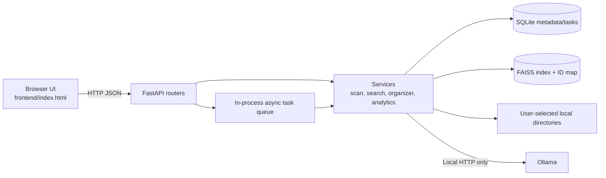
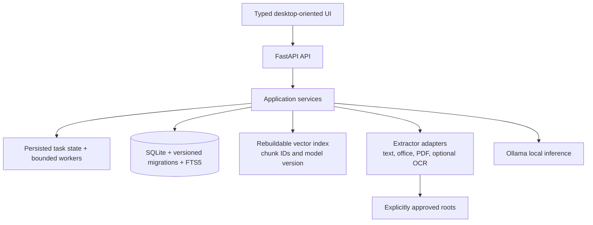

# Memora architecture (current foundation)

Memora retains SmartMem's local-process architecture while evolving the prototype in small, testable steps. The current implementation is a browser UI served by FastAPI, a local SQLite database, FAISS files on disk, and optional local Ollama inference.

## Boundaries

- Routers validate transport inputs and call services.
- Services own filesystem, retrieval, analytics, and model operations.
- SQLite stores selected roots, file metadata, cached extracted text, task records, and organizer history.
- FAISS stores dense vectors; the map links vector positions to file metadata IDs.
- Ollama is optional and local by default. File listing, scanning, hashing, and storage analysis do not inherently require it.

## Current design constraints

The queue is process-local; the task table does not itself provide durable execution. Current semantic retrieval is one vector per file, and FAISS/map persistence is not transactional with SQLite. These constraints are recorded in [PROJECT_AUDIT.md](PROJECT_AUDIT.md).

## Target evolution

SQLite remains appropriate for a single-user local app. FTS5 is a low-complexity lexical layer that can complement dense retrieval. A separate vector database or distributed task broker would add operational cost without a demonstrated local-user need. A Tauri wrapper can be evaluated after browser workflows and filesystem permission boundaries are stable; no Tauri project currently exists.
