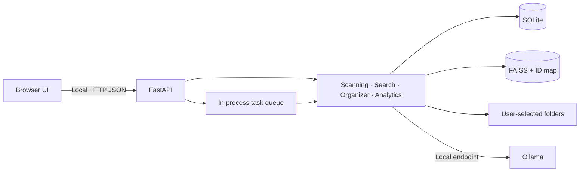

# Memora

> Your digital life, remembered intelligently.

Memora is the next name for SmartMem, a local-first file intelligence prototype. It scans user-selected folders, tracks file metadata, detects exact duplicates, offers storage views and AI-assisted categorization, and can index document text for local semantic search with Ollama and FAISS.

**Status:** early development. The current application is a FastAPI backend and a single-file HTML/CSS/JavaScript frontend. It is not yet a production release: search currently embeds one truncated representation per file, the task queue does not recover work after restart, and no automated test suite or desktop package is present. See [PROJECT_AUDIT.md](PROJECT_AUDIT.md) for verified findings and priorities.

## Current capabilities

- Add and scan explicitly selected local directories.
- Track file metadata and compute SHA-256 hashes for duplicate grouping.
- View storage, file categories, large files, and duplicate groups.
- Run AI-assisted categorization in dry-run mode by default; live moves have an undo log.
- Extract text from several common document, spreadsheet, presentation, text, and code formats.
- Index overlapping text passages in FAISS, combine dense retrieval with lexical search, and return source excerpts with match explanations.
- Continue filename/content keyword search when Ollama is unavailable.
- Open a selected result or its containing folder through an explicit user action.
- Track background task status and move requested deletions to a recycle directory.

These capabilities have not all received automated verification. OCR, audio transcription, chunked retrieval, cross-document answers with citations, smart collections, settings UI, and Tauri packaging are not currently implemented.

## Architecture



See [ARCHITECTURE.md](ARCHITECTURE.md) for current boundaries and the target direction.

## Technology

- Python 3.11+, FastAPI, Pydantic, aiosqlite
- SQLite and FAISS CPU
- Ollama for local model inference (optional for basic file workflows)
- Vanilla JavaScript, HTML, CSS, and browser-native SVG/canvas rendering

The UI does not fetch fonts or chart libraries from third-party CDNs. The browser UI is local; AI features still depend on the configured Ollama service, and optional document extraction depends on locally installed libraries.

## Development setup

Create a Python virtual environment and install the backend development requirements:

```powershell
cd backend
py -3.11 -m venv .venv
.\.venv\Scripts\Activate.ps1
python -m pip install -r requirements-dev.txt
uvicorn main:app --host 127.0.0.1 --port 8000 --reload
```

On macOS/Linux, use `python3 -m venv .venv`, activate `source .venv/bin/activate`, then run the same pip and uvicorn commands. Open `http://127.0.0.1:8000`; API docs are at `/docs`.

### Optional local AI

Install Ollama and pull models supported by the installed application, for example:

```sh
ollama pull llama3.2
ollama pull nomic-embed-text
```

Ollama defaults to `http://127.0.0.1:11434`. On backend startup, Memora checks the local API and attempts to start the installed Ollama server in the background if it is unavailable. This check runs asynchronously so it does not delay the UI or basic file workflows. Auto-start only applies to a loopback HTTP endpoint; remote/custom hosts are never launched. Set `OLLAMA_AUTOSTART=false` to disable this behavior, or enable Ollama in Windows Task Manager → Startup apps if you prefer Ollama to start at login. Basic metadata scanning, hashes, and storage analysis do not require it. Settings are read from environment variables in `backend/config.py`; `.env` loading and a user-facing settings page are not implemented.

## Configuration

| Variable | Default | Purpose |
| --- | --- | --- |
| `SMARTMEM_DB_PATH` | `backend/data/smartmem.db` | SQLite database path |
| `SMARTMEM_RECYCLE_BIN` | `~/.smartmem_recycle` | Destination for requested deletions |
| `OLLAMA_BASE` | `http://127.0.0.1:11434` | Local Ollama endpoint |
| `OLLAMA_TIMEOUT` | `60` | Model request timeout in seconds |
| `MEMORA_DOCUMENT_MAX_CHARS` | `100000` | Maximum extracted characters cached per file (bounded to 2,000,000) |
| `MEMORA_CHUNK_SIZE` | `1200` | Passage size in characters (bounded to 8,000) |
| `MEMORA_CHUNK_OVERLAP` | `160` | Overlap between passages |
| `ALLOWED_ORIGINS` | localhost list | CORS origin allowlist |
| `LOG_LEVEL` | `INFO` | Python logging level |

## Use

1. Add a directory in the Directories view.
2. Scan it and monitor the task queue.
3. Optionally compute hashes to populate duplicate groups.
4. Build the document index for semantic search (Ollama and FAISS required).
5. Review organizer suggestions in dry-run mode before enabling file moves.

Do not expose the API to an untrusted network. Review file operations before execution and retain independent backups.

## API

FastAPI's generated OpenAPI UI at `/docs` is the current authoritative API reference. Routes include directory selection, scanning, storage, duplicates, large files, organizer, semantic search, Ollama status, and task monitoring. Contracts may change while the audit priorities are addressed.

## Privacy and security

Read [SECURITY.md](SECURITY.md). The app stores paths, file metadata, optional extracted text, hashes, task state, categorization, and derived vectors locally. AI requests use the configured Ollama endpoint. Static UI assets do not call third-party hosts. Data is not encrypted by the app. The API now rejects non-loopback clients and unexpected Host headers; selected-root checks still are not authentication.

## Quality and contribution

Focused tests and a GitHub Actions pytest workflow now cover path guard behavior and interrupted task recovery. The wider feature suite remains incomplete, and the new tests could not be run in the current environment because its Python interpreter is missing. See [CONTRIBUTING.md](CONTRIBUTING.md) for development expectations and [CHANGELOG.md](CHANGELOG.md) for changes. A license has not been selected; the owner should choose one after confirming rights to all included work.

## Roadmap

The engineering priorities are documented in [PROJECT_AUDIT.md](PROJECT_AUDIT.md): add characterization tests and CI; repair task lifecycle and recovery; version database migrations; make vector state rebuildable and consistent; add chunk-level retrieval with source provenance; then improve frontend component boundaries, privacy/offline behavior, and desktop packaging.
